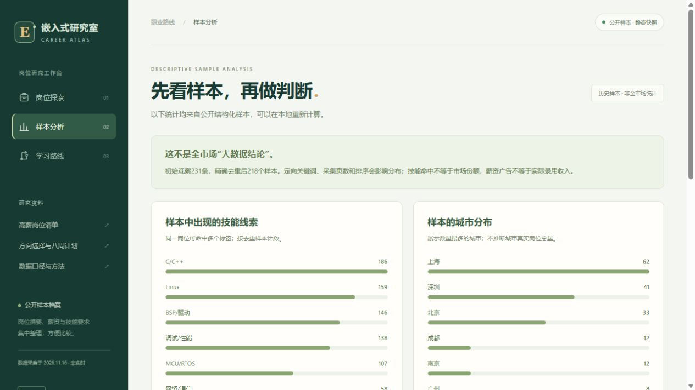

# 嵌入式岗位研究室

**从岗位样本观察技术要求，用可复算的统计辅助学习规划。**

这是一个无前端依赖的静态岗位探索工具，提供岗位摘要搜索、城市/方向/届别筛选、薪资分组观察、样本统计和通用学习路线。

- 在线浏览：https://foreverfine77.github.io/embedded-career-atlas/
- 数据快照：2026-11-16
- 初始观察：231条；精确去重后公开结构化样本：218个
- 公开集只含岗位字段和整理摘要，不含招聘方完整长文、联系方式或任何个人项目资料

## 界面预览

### 岗位探索


### 样本分析



### 通用学习路线


## 这份分析能说明什么

样本可以帮助观察：哪些技能在这批岗位中共同出现、不同岗位类型的薪资标注如何分布、如何把技能线索转成可检查的练习。

**这不是全市场“大数据分析”，也不是已证明的最高收益学习路线。** 定向关键词、采集页数、账号排序和发布日期会带来选择偏差。学习路线参考技能需求与工程先修关系，由人工整理；不是从薪资广告直接计算出来的结论。

薪资区间是招聘标注，非录用承诺；实习日薪、应届月薪和有经验社招分组观察。年包只是月薪乘标注月数的算术折算，不代表奖金保证发放。岗位可能已变更或关闭。

## 本地使用

直接打开`index.html`，或使用Python启动一个本地静态服务：

```bash
python -m http.server 8000
```

然后打开`http://localhost:8000`。页面不依赖CDN、在线字体或第三方分析服务。

更新公开结构化数据后，可用Python标准库重新生成浏览器数据和统计：

```bash
python scripts/build_data.py
python -m unittest discover -s tests -v
```

## 目录

```text
index.html                 静态页面
assets/                    页面样式、交互与生成后的公开数据
data/jobs.public.json      结构化公开样本（摘要，不是完整JD）
data/statistics.json       可复算的描述性统计
scripts/build_data.py      只读取公开输入的构建脚本
tests/                     数据边界和统计一致性检查
docs/methodology.md        采集范围、去重与统计口径
docs/learning-roadmap.md   通用八周学习示例
docs/salary-notes.md       薪资观察方法与局限
docs/screenshots/          公开页面截图
```

[查看按岗位类型分组的薪资观察清单](docs/salary-table.md)。

## 数据与隐私

公开包采用字段白名单重新生成。公司、岗位、城市、薪资、学历/年资标注和技能标签作为观察字段保留；不发布个人项目名称、研究课题、个人学习计划、账户资料、本机路径、设备信息、招聘联系人、原始界面转储或旧文件历史。

没有提供批量抓取工具或登录绕过功能。对于新数据，请先确认来源允许使用，删除个人信息，再按公开字段格式维护。

## 贡献

欢迎改进筛选体验、补充可解释的统计、指出摘要或归类错误。新增样本请注明观察日期与来源范围，不提交账号凭据、联系人信息或私有项目材料。

## 许可

代码使用[MIT许可](LICENSE)。公开数据与第三方名称的使用范围见[DATA-NOTICE.md](DATA-NOTICE.md)。
